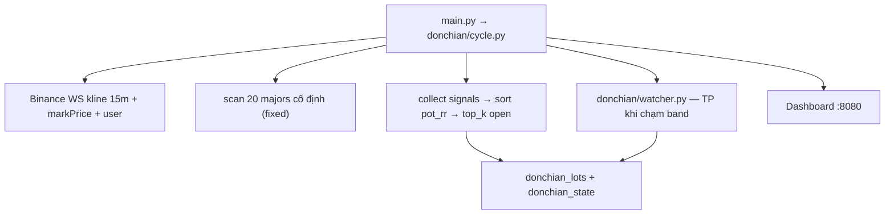
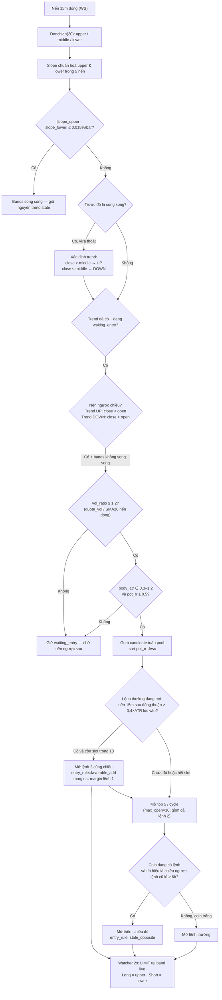
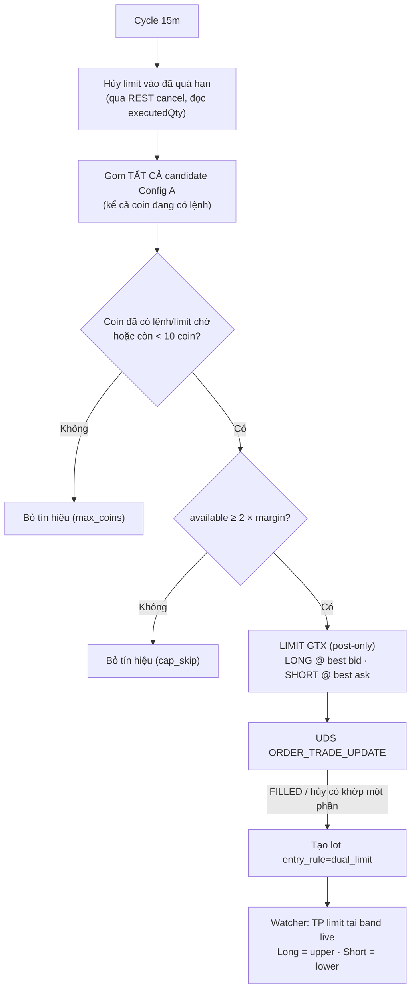
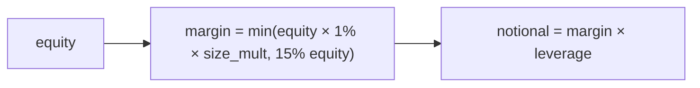

# Bot fade 5m vs nến 4h (USDT-M)

Bot live **fade 5m** (`FADE5M_ENABLED=true`) lot ~1 USDT × 10x. Tới **07:00 +07 21/10/2026** vẫn 20 coin (SOL XRP DOGE HYPE WLD SUI ARB ENA TIA ADA TAO FIL INJ DOT APT OP XLM TRX ATOM ZEC) — lệnh đang giữ follow cover/skip-add/đóng 4h bình thường. Từ 07:00 chỉ **vào lệnh mới** 5 coin: **XRP DOGE SUI XLM ATOM** (`FADE5M_SYMBOLS_NEXT` + `FADE5M_SWITCH_AT`). 07:00 là hết nến 4h nên đóng market sổ fade5m cả 20, rồi chỉ 5 coin đặt lại từ 07:10. Cover `opposite+1` vẫn có thể >1 USDT khi 4h đổi màu. Vào lệnh từ `FADE5M_START_AT` (23:00 +07 20/10/2026); trước giờ đó chỉ nghe WS, không đặt/hủy/đóng. Không đóng vị thế Supertrend/tay đang có trên sàn. Mỗi khi nến **5 phút đóng**: nếu nến **4h đang chạy** là xanh (close 5m cuối > open 4h) và nến 5m đó **đỏ** → **LONG**; 4h đỏ + 5m xanh → **SHORT**. Vào bằng **limit GTC** tại giá đóng 5m. Ký quỹ mặc định **1 USDT × 10**. Nếu 4h đổi màu và còn lệnh **ngược chiều** đã khớp, lệnh mới lấy **khối lượng ngược đó + 1 USDT**. Cover chưa khớp thì **chỉ giữ một lệnh**: hủy limit cover cũ, đặt lại giá đóng 5m mới, size vẫn opposite+1. Cùng chiều đang lãi thì không cộng thêm 1 USDT. Mỗi lệnh khớp treo **TP 1 ATR(14) nến 5m** (limit đóng, reduce-only); ATR chưa có hoặc đặt sàn thất bại thì bỏ TP, giữ lệnh tới hết 4h. Nến 5m cuối của 4h **không** đặt lệnh mới — hủy TP còn treo rồi **đóng market** toàn bộ sổ fade5m (pending + đã khớp). Không đụng vị thế Supertrend/Donchian/SMC còn lại trên sàn.

Màu 4h đang chạy lấy từ kline WebSocket 4h (`open` nến 4h đang chạy) so với `close` nến 5m vừa đóng (kline WS 5m). **Không REST klines** — restart không seed nến. Supertrend 4h, SMC và vòng Donchian **tắt**.

Dashboard `/`. Sổ SMC cũ `/so-lenh`. Donchian `/donchian`.

---

# Bot Prediction 5m / 15m / 1h BTC/ETH/BNB

Code `src/predict5m`. Bật bằng `PREDICT5M_ENABLED` + `PREDICT5M_TRADING_ENABLED`. Gắn vòng live `cycle.py` (ưu tiên hơn fade/trend/SMC). Dashboard `/` và `/predict`. Discord **chỉ khi thắng**, khi ví không đủ (dừng 1h), hoặc khi lỗi.

Ba khung **5m, 15m, 1h**. BTCUSDT / ETHUSDT / BNBUSDT trên Binance Prediction Markets (Up/Down). **Cùng lúc một** cược mở (mọi khung). Cùng lúc có tín hiệu thì ưu tiên khung nhỏ: 5m rồi 15m rồi 1h. Coin đầu tiên có tín hiệu trong khung được chọn. Luật tín hiệu giống nhau trên nến **đã đóng** của đúng khung đó (`closeTime < now`) — nến đang chạy không được đánh giá. Đủ điều kiện trên nến đóng rồi đặt **ngay mở nến kế** (cửa Prediction), không lấy nến đang mở làm tín hiệu:

1. Nhãn TV **default ON**: Engulfing (BE), Hammer, Dragonfly Doji, Abandoned Baby — latch = nhãn xanh/đỏ **gần nhất** trên đúng khung đó. Pattern tắt mặc định (Marubozu, Long Lower Shadow, Harami, Tweezer, Piercing, **STW/STB**…) **không** đổi latch. Chỉ nhãn xám **D** (Doji, mặc định bật) hoặc xanh và đỏ cùng một nến mới xóa latch.
2. SQZMOM chấm **xám** (`sqzOff`).
3. Hist cùng phía nhãn (xanh lime/green với nhãn xanh; đỏ red/maroon với nhãn đỏ).
4. Nến vừa đóng là nến **ngược** (nhãn xanh + nến đỏ, hoặc nhãn đỏ + nến xanh).

Tín hiệu đúng thì treo **LIMIT** tại giá share sao cho **thắng lãi ≥ 2 lần vốn** (`price ≈ (1−fee)/3`, làm tròn xuống tick). Không khớp market giá mở cửa. Hết cửa bot đọc trạng thái lệnh: **chưa khớp** thì **không đổi target** (sàn tự hủy LIMIT khi đóng cửa, bot không hủy); đã khớp thì lấy nến cùng khung quyết thắng/thua. Vốn: target lãi mặc định **2 USDT** (`PREDICT5M_TARGET_USDT`, tối thiểu để vốn vào ≥ 1 USDT sàn). Vốn vào = target / 2 vì LIMIT lời 2×. Thua (đã khớp): target sau = **lỗ lũy kế + 2** (thắng gỡ hết lỗ rồi còn đúng 2 USDT). Thắng hoặc hết ví thì reset target 2. Dùng chung mọi khung. Trước mỗi lệnh bot đọc số dư ví Prediction (CeDeFi). **Không đủ tiền** thì **dừng 1 giờ**. Discord khi thắng, khi lỗi, hoặc khi dừng 1h vì hết ví. Lãi lỗ và lịch sử lệnh xem trên dashboard.

---

# Bot Supertrend 4h + ADX (USDT-M) — không chạy

Bot live **không** chạy Supertrend 4h khi `FADE5M_ENABLED=true`. Mô tả dưới đây giữ cho code `src/trend4h`.

Bot Supertrend 4h + ADX (`TREND4H_ENABLED=true` khi fade 5m tắt). 20 coin majors. Supertrend(10, 3) trên nến 4 giờ. Chỉ **mở hoặc đảo** khi ADX(14) ≥ 25; ADX thấp không cắt lệnh đang giữ. Một vị thế mỗi coin, ký quỹ **1 USDT × 10**, vào/ra **market taker** tại giá đóng nến 4h. REST kline 4h seed từng coin cách 2,5 giây; không warmup REST 15m.

Backtest (1 USDT × 10, taker): OP full 2022-06→2026-09 **+42,5** PF 1,60; năm 2025-10→2026-09 **+8,3**; 20 coin full **18/20 lời, +576**.

---

# Bot SMC đảo chiều (USDT-M) — không chạy

Bot live **không** chạy SMC đảo chiều khi `TREND4H_ENABLED=true`. Mô tả dưới đây giữ cho `/so-lenh` và backtest cũ.

Bot SMC trên nến 15 phút (`SMC_ENABLED=true` khi trend 4h tắt). Vốn futures dùng chung. Mỗi coin tối đa một lệnh. Mỗi lệnh mới dùng đòn bẩy **10** và ký quỹ **10%** equity. Giá chốt lời và cắt lỗ giữ nguyên. Lệnh có mức chốt lời không đủ trả phí một vòng (taker 0.05% lúc vào + maker 0.02% lúc chốt, tính trên notional của lệnh) không được đặt.

Swing 50 nến. Tín hiệu long khi râu xuyên dưới đáy swing, nến đóng lại phía trên đáy, và đoạn râu không dài quá **0.8 ATR(14)**. Tín hiệu short là ảnh đối xứng ở đỉnh swing. Lệnh đặt ra đảo chiều tín hiệu đó: long thành short và ngược lại, chốt lời tại đầu râu, cắt lỗ tại trung điểm. Vào lệnh bằng STOP_MARKET đúng tại đỉnh hoặc đáy vừa quét, nên lệnh nằm chờ đến khi giá chạm mức đó. Nến tín hiệu đã đóng qua cắt lỗ thì bỏ. Ngay khi stop khớp, bot treo limit chốt tại đầu râu và STOP_MARKET tại trung điểm, rồi gửi Discord. Đóng lệnh (chốt hoặc cắt) cũng gửi Discord. Lệnh đã khớp được giữ đến khi chạm chốt lời hoặc cắt lỗ, không đóng theo đồng hồ. Nếu 15 phút trước lúc khớp giá chạy ngược chiều lệnh hoặc đi ngang, bot đóng market phần dư để phần còn lại bằng **1%** equity, rồi chỉnh chốt lời và cắt lỗ theo phần đó. Cùng chiều thì giữ **10%**. Chưa đủ giá 15 phút trong bộ nhớ thì giữ **10%**. Lệnh chờ tối đa **16** nến. Giá chạm cắt lỗ trước khi khớp thì hủy stop vào. Tín hiệu chỉ được đặt lúc nến vừa đóng và coin đã trống suốt nến đó. Coin vừa khớp thì nghỉ thêm một nến, không lấy tín hiệu mới trong nến khớp hoặc nến kế tiếp.

Backtest luật size này trên đúng giai đoạn bot SMC đã chạy, từ 12/10/2026 15:00 đến 19/10/2026 08:45 (giờ VN). Vốn đầu 949,64 USDT, lấy từ số dư lúc bot bắt đầu quét. Tín hiệu dò lại trên cửa sổ 400 nến 15 phút, khớp và đóng theo nến 1 phút. Cùng chiều giữ 10% equity, ngược chiều hoặc đi ngang giữ 1%. Kết quả: 143 lệnh, winrate 65% (93 lệnh lãi), RR 0,92 (lãi trung bình 2,18 USDT, lỗ trung bình 2,36 USDT), PnL **+84,99** USDT, vốn cuối 1.034,64. 132 lệnh chạm chốt lời cộng 176,56; 11 lệnh cắt lỗ trừ 91,57. Trong 50 lệnh lỗ, 44 lệnh ngược chiều (88%), 4 lệnh đi ngang, 2 lệnh cùng chiều. Hai lệnh cùng chiều lỗ là BCH short 14/10 (−16,77) và AVAX long 16/10 (−53,40).

Cùng kỳ, luật cũ 2% và cắt còn một nửa lãi +17,04, winrate 86%, RR 0,26. Chỉ vào lệnh cùng chiều với size 10% lãi sổ +86,75, winrate 96%, RR 0,07. Giá khớp lấy đúng giá stop, chưa tính funding và bước làm tròn khối lượng sàn.

Dashboard chính là sổ SMC. Sổ Donchian 2 chiều giữ ở [`/donchian`](/donchian). Dashboard cũ hơn ở `/legacy`.

Đặt `SMC_ENABLED=false` để quay lại vòng Donchian mô tả bên dưới.

---

# Bot Donchian Parallel-Trend (USDT-M)

Bot chạy vòng **15 phút**, chiến lược **Donchian parallel-trend + volume** trên nến **15m**: khi 2 band trên/dưới của Donchian Channel **chuyển từ song song sang không song song**, xác định xu hướng theo vị trí close so với band giữa; đợi nến ngược chiều → lọc **vol_ratio** (quote volume / SMA20) + body ATR + pot RR → xếp hạng theo `pot_rr`, mở **top 5** mỗi cycle; thoát khi giá chạm band Donchian hiện tại (không SL cứng). Nếu lệnh thường đã chạy đúng hướng đủ **0,4 ATR**, bot mở **đúng một lệnh 2** cùng chiều, cùng margin, và cả hai lệnh vẫn tính vào trần **10**.

> **Chế độ hiện tại: limit 2 chiều** (`DONCHIAN_DUAL_LIMIT=true`, mặc định). Tín hiệu giữ nguyên Config A, nhưng **cách vào lệnh thay đổi**: mỗi tín hiệu đặt một cặp limit post-only LONG + SHORT, không vào market, không top 5, không trần 10 lệnh, chỉ trần **10 coin**. Xem [mục 2b](#2b-chế-độ-limit-2-chiều). Đặt `DONCHIAN_DUAL_LIMIT=false` để quay về logic market cũ mô tả bên dưới.

**Entry point:** `python -m src.main` → `src/donchian/cycle.py`

**Backtest tham chiếu (Config A):** [`backtest_channel_vol_dual_1y_3y.md`](backtest_channel_vol_dual_1y_3y.md) · `scripts/backtest_price_vol_channel_run.py`

---

## 0. Multi-exchange

| Env | Ý nghĩa |
|-----|---------|
| `EXCHANGE=binance` | Binance USDT-M (`fapi.binance.com`) |
| `BINANCE_API_KEY` / `BINANCE_SECRET_KEY` | API key Binance Futures |

---

## 1. Kiến trúc



| Module | Vai trò |
|--------|---------|
| `src/donchian/cycle.py` | Vòng 15m: lệnh 2, rồi scan pool, detect signal, rank top_k, mở lệnh |
| `src/donchian/signals.py` | Donchian bands, parallel, vol/body/RR filter, `EntrySignal` |
| `src/donchian/favorable_add.py` | Điều kiện lệnh 2: close thuận ≥ 0,4 ATR so với lệnh gốc |
| `src/donchian/trading.py` | Market open/close; margin lệnh mới = min(equity × 1% × size_mult, 15% equity); lệnh 2 copy margin lệnh 1 |
| `src/donchian/watcher.py` | Mark WS mỗi 2s: TP khi chạm band Donchian |
| `src/donchian/store.py` | SQLite `donchian_lots` + `donchian_state` |
| `src/exchange/` | REST + WS, rate limit, cache |
| `src/web/app.py` | Dashboard Donchian |

---

## 2. Logic tín hiệu



**Đóng lệnh (Binance):** không SL cứng. Watcher mỗi **2 giây** đặt lệnh **LIMIT GTC** đúng band Donchian đang hình thành (long = upper, short = lower), hedge mode `positionSide`, không dùng `reduceOnly`. Chỉ đổi giá limit khi giá format thay đổi và lệnh chưa khớp một phần. Không chốt trên chính nến vào lệnh. Phí đóng khi limit khớp là **maker**. Vào lệnh vẫn là **market taker**.

**Quy tắc vào lệnh:**

1. Donchian period **20** · slope lookback **5** · parallel tol **0.015 %/bar**.
2. Trend tại nến **đầu tiên** bands thoát song song (`close > middle` → UP, else DOWN) → `waiting_entry=True`.
3. Chờ **nến ngược chiều** trong khi bands vẫn **không** song song:
   - UP → nến đỏ (`close < open`) → LONG
   - DOWN → nến xanh (`close > open`) → SHORT
4. **Lọc volume (counter candle):**
   - `vol_ratio = quote_volume_nến_đóng / SMA(20)` (mặc định period **20**)
   - **`DONCHIAN_MIN_VOL_RATIO=1.2`** — volume nến counter ≥ 120% TB 20 nến
   - Nếu thiếu `quote_volume`: fallback `volume × close`
   - Fail → **giữ** `waiting_entry`
5. **Lọc chất lượng (body_size_rr05):**
   - `body_atr = |close − open| / ATR(14)` ∈ **[0.3, 1.2]**
   - `pot_rr = dist(entry, TP band) / dist(entry, opposite band)` ≥ **0.5**
   - Fail → **giữ** `waiting_entry`
6. Pass → `size_mult = min(pot_rr, 2.0)` (Config A backtest).
7. **Mỗi cycle 15m:** gom tất cả candidate trong pool → sort `pot_rr` giảm dần → mở tối đa **`DONCHIAN_TOP_K=5`**, dừng khi **`DONCHIAN_MAX_OPEN=10`**. Trần 10 tính mọi lot đang mở, kể cả lệnh 2 và quy tắc ngược.
8. Mở market. Mỗi coin bình thường **một chiều**. Ngoại lệ **quy tắc ngược** (`DONCHIAN_STALE_OPP_HOURS=6`):
   - Lệnh đang mở trên coin đó đã ≥ **6 giờ** và **đang lỗ** (lãi lỗ tạm tính theo mark ≤ 0).
   - Có tín hiệu Config A **chiều ngược**, lọt top 5, còn slot trong 10 lệnh, ví đủ margin.
   - Mở thêm lệnh đó. Lệnh cũ không cắt, vẫn chốt tại band của chiều nó.
   - Lệnh mới ghi `entry_rule=stale_opposite`.
   - Discord tiêu đề có **quy tắc ngược**. Dashboard có bảng riêng và nhãn trên thẻ lệnh.
9. **Lệnh 2** (`DONCHIAN_ADD_ATR_MULT=0.4`, đặt `0` để tắt). Đây là một lệnh cùng chiều sau khi lệnh gốc đã chạy đúng hướng, không phải lưới giá và không phải DCA nhiều bậc.
   - Mỗi cycle, **trước** khi mở top 5, bot xét từng lệnh gốc đang mở.
   - Lệnh gốc là `entry_rule` trống hoặc `standard`. `stale_opposite` không được thêm lệnh 2. Nếu chiều đó đã có `favorable_add` thì không thêm nữa.
   - Nến 15m **đã đóng** phải có `ts` sau `entry_ts` của lệnh gốc (không xét chính nến vào lệnh).
   - Long: `close − entry ≥ 0,4 × ATR`. Short: `entry − close ≥ 0,4 × ATR`.
   - ATR là ATR(14) **của nến vào lệnh gốc**, lưu ở `entry_atr` lúc mở. Lot cũ chưa có cột này thì bot tính lại từ cache nến nếu nến vào còn trong cửa sổ ~114 nến; hết cache thì bỏ qua lệnh đó.
   - Margin và `size_mult` **copy từ lệnh gốc**, không tính lại theo equity lúc thêm. Notional = margin × 10.
   - Vào market, `entry_rule=favorable_add`. Watcher đặt limit TP riêng tại band live của chiều đó.
   - Đã đủ 10 lệnh, hoặc available nhỏ hơn margin: **bỏ qua cycle này và thử lại cycle sau** khi close vẫn còn vượt ngưỡng. Không đánh dấu là đã thêm.
   - Discord tiêu đề **lệnh 2**. Thẻ dashboard hiện nhãn **Lệnh 2**.
10. Watcher giữ limit TP tại band cho từng lot (hai chiều cùng coin, hoặc lệnh gốc và lệnh 2).

**State `waiting_entry`:**

- Clear khi **mở lệnh thành công** hoặc `cap_skip` của lệnh mới (hết slot / thiếu margin) — không queue.
- Candidate không vào top_k: **giữ** `waiting_entry=True`.
- Coin đang có lệnh: vẫn theo dõi nến. Tín hiệu cùng chiều, hoặc tín hiệu ngược chưa đủ 6 giờ / chưa lỗ, **không** vào danh sách top 5 và **giữ** waiting để nến sau còn xét.
- Lỗi sàn khi chưa có đúng chiều đó: retry chu kỳ sau.
- Filter fail **không** clear `waiting_entry`.

### Discord khi mở lệnh

Notify giải thích **vì sao vào** + **vì sao size đó**, ví dụ:

```
LINKUSDT LONG mở — trend UP
lý do: thoát song song → UP; nến đỏ ngược chiều; band không song song; vol_ratio=1.35 (≥1.20)
lọc: body_atr=0.72 (ok 0.3–1.2) · pot_rr=0.85 (≥0.5) · vol_ratio=1.35 (≥1.2)
size: size_mult=0.85× · margin_pct=1.00% → margin=8.50 USDT (equity≈1000)
entry=...
target band=... · opp band=...
size=...
```

---

## 2b. Chế độ limit 2 chiều

Bật bằng `DONCHIAN_DUAL_LIMIT=true`. Phát hiện tín hiệu (mục 2, bước 1–6) **không đổi**. Thay đổi ở bước vào lệnh:



| Quy tắc | Giá trị |
|---|---|
| Tín hiệu | Mọi candidate Config A trong cycle, không lấy top 5 |
| Lệnh vào | `LIMIT` `timeInForce=GTX` (post-only, luôn maker). Bị từ chối `-5022` thì đọc lại giá và thử 1 lần |
| Giá | Long = best bid, Short = best ask (bookTicker REST, weight 2). Không đọc được thì dùng mark WS, làm tròn xuống cho long và lên cho short |
| Hết hạn | Hủy khi đã đóng thêm `DONCHIAN_ENTRY_TTL_BARS` nến (mặc định 1) sau nến tín hiệu. Khớp một phần thì giữ phần đã khớp thành lot |
| Margin mỗi chiều | Như cũ: min(equity × 1% × size_mult, 15% equity). Cần available ≥ 2 × margin, trừ phần đã đặt trong cùng cycle |
| Số lệnh | Không giới hạn. Coin đang có lệnh vẫn nhận cặp mới ở mỗi tín hiệu |
| Số coin | Tối đa `DONCHIAN_MAX_COINS=10` coin đang có lot mở hoặc limit chờ. Tính cả lot cũ |
| Thoát | Như cũ: TP limit tại band live, không SL |
| Phí vào | Commission từ UDS. Không có thì ước tính `DONCHIAN_MAKER_FEE_RATE=0.0002` |
| Tắt | Lệnh market thường, quy tắc ngược, lệnh 2 (`favorable_add`) |

**TP dùng chung theo chiều.** Hedge mode gộp mọi lot cùng coin cùng chiều thành một vị thế, và mọi lot cùng chiều có chung giá TP (band live). Bot giữ **một** lệnh TP cho cả vị thế:
- Lưu `tp_limit_qty`. Vị thế lớn lên (lot mới khớp) thì hủy và đặt lại TP với size mới.
- TP khớp thì đóng mọi lot giữ order đó, chia phí theo size. Nếu `executedQty` phủ hết vị thế, đóng luôn các lot cùng chiều chưa kịp gắn TP.
- Không bao giờ nhận nhầm limit vào lệnh (SELL của short) làm TP của long: lọc theo `positionSide` và danh sách limit vào đang chờ.

**Rate limit:**
- Khớp lệnh vào: UDS. Watcher mỗi 2s chỉ đọc cache WS, không gọi REST.
- REST mỗi tín hiệu: 1 bookTicker (bỏ qua khi REST optional bị chặn) + 2 POST order. Cấu hình symbol (dual side / margin type / leverage) chỉ gọi một lần mỗi coin mỗi lần chạy bot.
- REST khi hết hạn: 1 DELETE mỗi lệnh. Chỉ khi sàn báo "unknown order" mới GET /order (optional, bỏ qua khi bị chặn và thử lại cycle sau).
- Đang REST cooldown/ban: không đặt cặp mới, giữ `waiting_entry` chờ nến ngược sau.
- Dashboard mới chỉ đọc DB + cache WS.

**State `waiting_entry` (chế độ 2 chiều):** đặt được ít nhất một chiều → clear. `max_coins` / thiếu margin → clear (bỏ tín hiệu). Lỗi sàn / đang cooldown → giữ, chờ nến ngược sau.

**Dashboard:** `/` là dashboard mới, mốc = equity futures lúc bot chạy chế độ này lần đầu (lưu `dual_book_at`, `dual_book_anchor` trong `settings`). Dashboard cũ tạm ẩn ở `/legacy`. Muốn chốt lại mốc: xóa 3 key `dual_book_*` trong bảng `settings`, bot sẽ chốt lại ở cycle kế tiếp.

---

## 3. Sizing và phí



| | Giá trị |
|---|---------|
| Base margin | **1% equity** (`DONCHIAN_MARGIN_PCT=0.01`) |
| Margin cap | **15% equity** / lệnh (`DONCHIAN_MARGIN_CAP_PCT=0.15`) |
| Size scale | `size_mult = min(pot_rr, 2.0)` khi `DONCHIAN_SIZE_BY_RR=true` |
| Leverage | `10x` |
| Max lệnh mở | **10** (`DONCHIAN_MAX_OPEN`) |
| Top-K / cycle | **5** (`DONCHIAN_TOP_K`) |
| Phí live | Vào market: taker Binance (thường 0,05%). Đóng limit khớp: maker (thường 0,02%). Backtest giấy dùng 0,04%/chiều. |

Ví dụ equity 1000 USDT, `pot_rr=0.85` → `size_mult=0.85`: margin = min(8.50, 150) = **8.50 USDT**, notional = 85 USDT.

Lệnh 2 dùng đúng `margin_usdt` đã lưu của lệnh gốc. Equity lúc thêm không đổi con số đó. Ví vẫn phải còn available ≥ margin đó, và tổng lot mở vẫn ≤ 10.

### Tương thích lệnh đang chạy (deploy)

**Giữ nguyên — không đóng, không resize lot đang mở.**

| Việc | Hành vi |
|------|---------|
| Lot `status=open` | Watcher vẫn TP theo band Donchian live |
| Size / margin lot cũ | Giữ lúc mở; không chỉnh |
| Filter / top_k / max_open | Chỉ khi **mở lệnh mới** |
| Symbol đang có lot mở | Giữ lot. Mở thêm chiều ngược khi lot đó lỗ ≥ `DONCHIAN_STALE_OPP_HOURS` (mặc định 6) và có tín hiệu Config A. Mở đúng một lệnh 2 cùng chiều khi nến sau đóng thuận ≥ `DONCHIAN_ADD_ATR_MULT` (mặc định 0,4) ATR lúc vào |

---

## 4. Symbol scan pool

**Mặc định (khớp backtest Config A):** `DONCHIAN_SCAN_MODE=fixed` — **20 majors cố định**:

BTC, ETH, BNB, SOL, XRP, TRX, ADA, AVAX, DOT, LINK, LTC, BCH, XLM, ATOM, NEAR, APT, SUI, ARB, OP, UNI.

- Override: `DONCHIAN_FIXED_SYMBOLS=BTCUSDT,...`
- **Không** áp symbol filter (listing/range) trên pool fixed — khớp backtest.
- Boot **không** chờ miniTicker volume rank.

**Tùy chọn:** `DONCHIAN_SCAN_MODE=volume` — top-N theo 24h quote volume (`DONCHIAN_TOP_N=30`). Symbol filter bật qua `DONCHIAN_SYMBOL_FILTER=true` (listing ≥365d, range ≤15% cho non-major).

`set_watched_symbols(pool + open lots)` → KlineStream subscribe cả coin đang giữ lệnh.

---

## 5. Boot sequence & rate limit safety

```
main() →
  init_db() + ensure_schema()
  mark_boot_rest_quiet()
  start_binance_ws()
  _wait_binance_ws_ready()
  _start_boot_warmup(fixed 20)
  start_watcher()
  vòng lặp cycle 15m
```

- Warmup REST tuần tự — `boot_optional_rest_slot()` + `REST_BOOT_GAP_SEC`
- Scan candles trong cycle: **WS-only**, không REST
- Critical orders không bị block bởi rate limit

---

## 6. SQLite schema

| Bảng | Việc |
|------|------|
| `donchian_lots` | Lot mở/đóng; `pnl_usdt` net sau phí; `entry_rule` = `standard`, `stale_opposite`, hoặc `favorable_add`; `entry_atr` = ATR(14) tại nến vào |
| `donchian_state` | Trend state per symbol |
| `equity_snapshots` | Chart equity dashboard |

---

## 7. Backtest tham chiếu — Config A (channel + counter + vol≥1.2)

Cùng logic live: Donchian 20 · parallel exit · counter · body/RR · **vol≥1.2** · **top_k=5** · **max_open=10** · margin 1% (cap 15%) · pool **20 majors** · shared wallet · **không** breadth.

**Doc đầy đủ:** [`backtest_channel_vol_dual_1y_3y.md`](backtest_channel_vol_dual_1y_3y.md) · `scripts/backtest_price_vol_channel_run.py`

| Config A | 365d | ~1095d |
|----------|------|--------|
| PF | **1.47** | **1.46** |
| Win rate | 71.3% | 71.7% |
| MaxDD | 38.7% | 52.3% |
| Lệnh / ngày | 28.5 | 28.7 |
| %/ngày (365d) | +5.95% | —* |

\*Return % 3y compound không dùng kỳ vọng live. So **PF ~1.46**, **WR ~71%**, **MaxDD 39–52%**.

### Live ↔ backtest — khớp / khác

| Hạng mục | Backtest Config A | Live |
|----------|-------------------|------|
| Signal (Donchian, vol, body, RR) | ✓ | ✓ |
| Pool 20 majors fixed | ✓ | ✓ |
| max_open=10, top_k=5 | ✓ | ✓ |
| margin 1% × min(pot_rr, 2), cap 15% | ✓ | ✓ |
| Symbol filter | không | không (fixed mode) |
| Breadth flip | không | không |
| TP timing | chạm band trên nến đóng, khớp tại band | limit GTC tại band live, đổi khi giá format đổi; không TP nến vào |
| Fill | close nến, không slippage | vào market; đóng maker tại limit |
| Quy tắc ngược | có trong lần nghiên cứu, không phải Config A gốc | bật: lỗ ≥ 6h + tín hiệu ngược cùng coin |
| Lệnh 2 | cùng ngưỡng 0,4×ATR lúc vào, cùng margin lệnh gốc, một lần, trần 10 chặn cả lệnh 2 | bật: `favorable_add`, thử lại cycle sau nếu hết slot hoặc thiếu margin |
| Rút cuối tháng | không trong BT trade-only | hết lãi tháng, trần 8% equity đầu tháng, 07:00 +07 ngày 1 |

---

Rút futures → spot: **một lần** lúc 07:00 +07 **ngày 1** tháng sau. Số rút = lãi so với mốc equity đầu tháng, và không vượt **8%** mốc đó. Tháng lỗ thì không rút. Mốc tháng 2026-10 dùng cho sổ hiện tại là **1051** USDT.

## 8. Env vars

```
EXCHANGE=binance
BINANCE_API_KEY=...
BINANCE_SECRET_KEY=...

DONCHIAN_PERIOD=20
DONCHIAN_SLOPE_LB=5
DONCHIAN_PARALLEL_TOL=0.015
DONCHIAN_INTERVAL=15m
DONCHIAN_MARGIN_PCT=0.01
DONCHIAN_MARGIN_CAP_PCT=0.15
DONCHIAN_ATR_PERIOD=14
DONCHIAN_MIN_BODY_ATR=0.3
DONCHIAN_MAX_BODY_ATR=1.2
DONCHIAN_MIN_POT_RR=0.5
DONCHIAN_SIZE_BY_RR=true
DONCHIAN_MIN_VOL_RATIO=1.2
DONCHIAN_VOL_RATIO_PERIOD=20
DONCHIAN_MAX_OPEN=10
DONCHIAN_TOP_K=5
DONCHIAN_STALE_OPP_HOURS=6
DONCHIAN_ADD_ATR_MULT=0.4
DONCHIAN_DUAL_LIMIT=true
DONCHIAN_MAX_COINS=10
DONCHIAN_ENTRY_TTL_BARS=1
DONCHIAN_MAKER_FEE_RATE=0.0002
DONCHIAN_SCAN_MODE=fixed
DONCHIAN_SYMBOL_FILTER=false
DONCHIAN_TOP_N=30
LEVERAGE=10
TRADING_ENABLED=true

SPOT_TRANSFER_ENABLED=true
SPOT_TRANSFER_MODE=month
SPOT_TRANSFER_MONTH_CAP_PCT=8
SPOT_TRANSFER_EXECUTE_HHMM=0700
```

---

## 9. File map

| File | Việc |
|------|------|
| `src/main.py` | Entry → `donchian.cycle.main()` |
| `src/donchian/cycle.py` | Vòng 15m, scan, rank top_k, boot warmup, spot transfer |
| `src/donchian/signals.py` | Donchian bands, filters, `EntrySignal` |
| `src/donchian/trading.py` | Open/close lot, sizing, Discord why |
| `src/donchian/watcher.py` | Mỗi 2s: limit TP tại band live |
| `src/donchian/stale_opposite.py` | Điều kiện lệnh ngược (lỗ ≥ 6 giờ) |
| `src/donchian/favorable_add.py` | Chọn lệnh gốc và ngưỡng 0,4 ATR của lệnh 2 |
| `src/donchian/dual_limit.py` | Limit 2 chiều: đặt cặp post-only, trần 10 coin, hủy hết hạn, khớp → lot |
| `src/donchian/store.py` | SQLite schema + CRUD (gồm `donchian_entry_orders`) |
| `src/spot_transfer.py` | Rút cuối tháng (hết lãi, trần 8% mốc đầu tháng), lịch sử, risk warn |
| `src/web/app.py` | Dashboard mới `/` + `/api/dual/status`; dashboard cũ `/legacy` |
| `src/web/templates/dual.html` | Giao diện dashboard mới (mốc = equity futures) |
| `scripts/backtest_price_vol_channel.py` | Engine backtest Config A |
